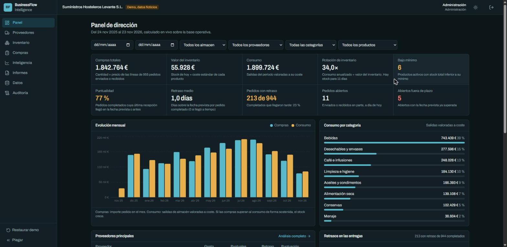
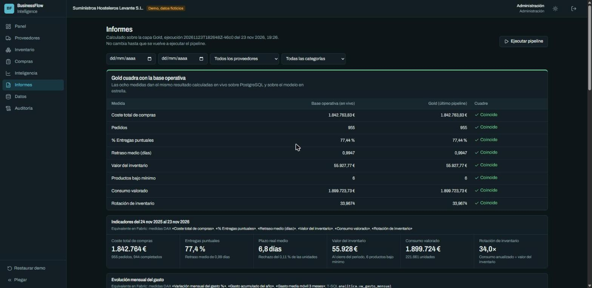
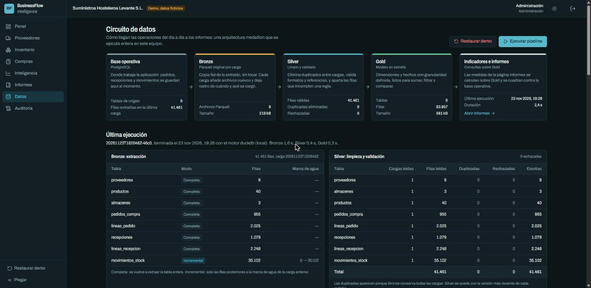
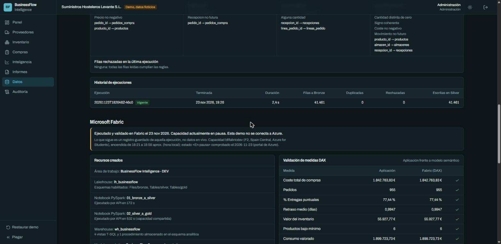
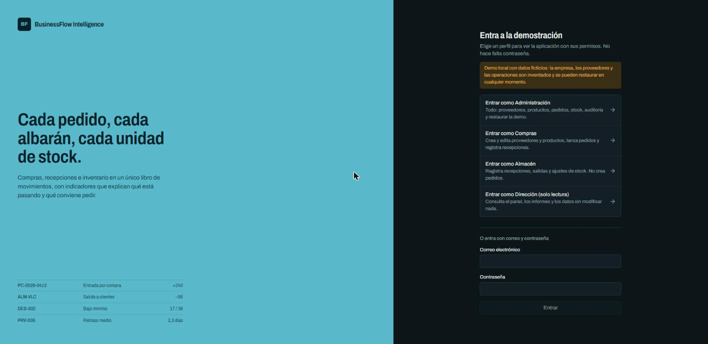
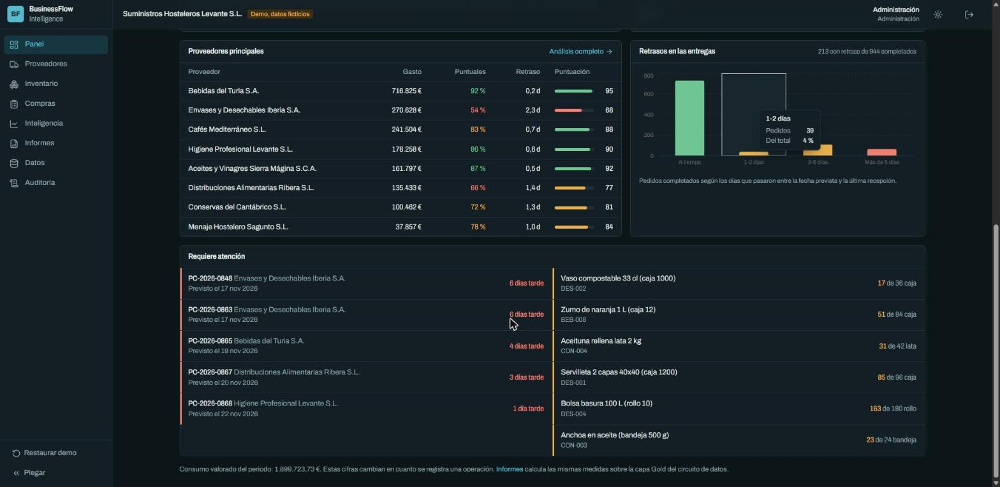
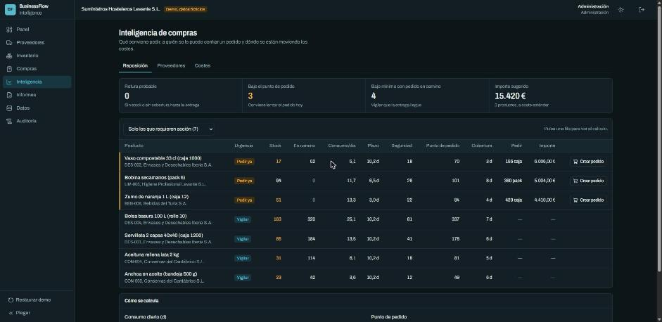
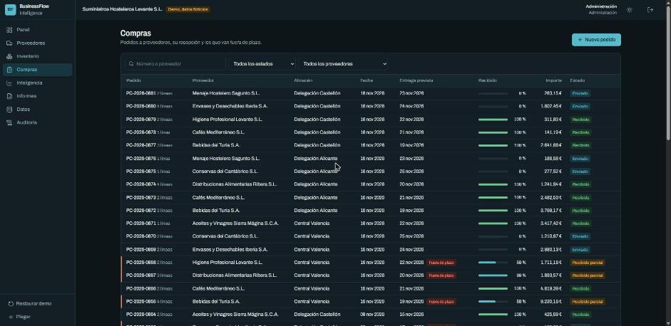
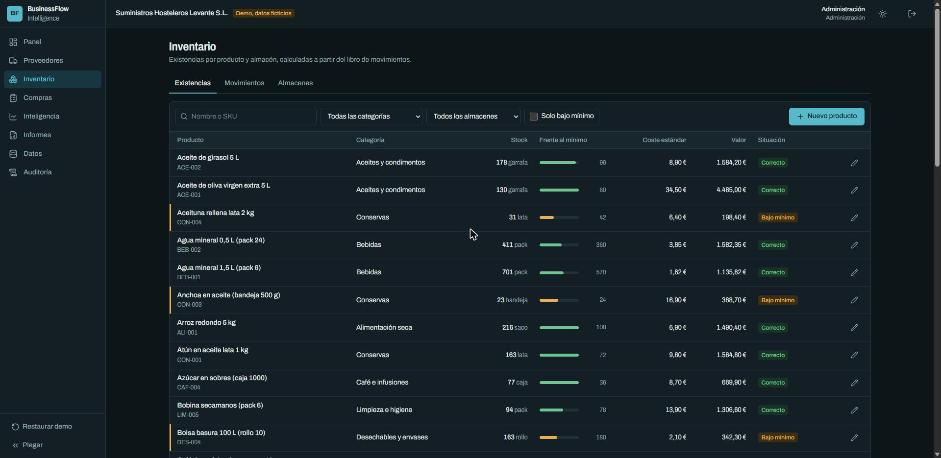

# BusinessFlow Intelligence

Aplicación de **compras, recepciones e inventario** para una pyme, con un **circuito de datos en arquitectura medallion** (Bronze → Silver → Gold) y un panel de indicadores. Funciona entera en local con datos ficticios. La misma lógica de datos está escrita también en PySpark para Microsoft Fabric y se ejecutó allí una vez para validarla (ver [Microsoft Fabric](#microsoft-fabric)).

Todos los datos son inventados: los genera un simulador determinista que reproduce 12 meses de actividad de un distribuidor de suministros de hostelería. Los identificadores fiscales de demostración tienen la forma `DEMO0000n`, los teléfonos `+34 000 000 00n` y los correos usan el dominio reservado `.example`.



## Qué hace

| Apartado | Qué hace |
|---|---|
| **Panel** | Compras, evolución mensual, proveedores principales, puntualidad, retrasos, bajo mínimo, valor del inventario, consumo y rotación. Filtros por fechas, almacén, proveedor, categoría y producto. Se calcula en vivo sobre la base operativa. |
| **Proveedores** | Alta, edición, búsqueda, estados e historial con sus métricas. |
| **Inventario** | Existencias por producto y almacén, movimientos, salidas y ajustes. |
| **Compras** | Pedidos con líneas, envío, cancelación y recepciones parciales con rechazos. |
| **Inteligencia** | Recomendaciones de reposición con la fórmula visible, rendimiento de proveedores y análisis de costes. |
| **Informes** | Los mismos indicadores calculados sobre la capa **Gold**, con un cuadre contra la base operativa. |
| **Datos** | El circuito Bronze → Silver → Gold: se ejecuta con un botón y muestra qué pasó en cada capa. Incluye un registro estático de la ejecución en Fabric. |
| **Auditoría** | Registro de las operaciones de escritura. |

Cuatro perfiles con permisos distintos: Administración, Compras, Almacén y Dirección (solo lectura). Autenticación con JWT, validación de entradas con zod y límite de intentos de acceso.

## Arquitectura

```
                        ┌─────────────────────────── en vivo ───────────────────────────┐
                        │                                                               ▼
 React + Vite  ──HTTP──► API Express ──► PostgreSQL 16 (base operativa)               Panel
 Tailwind                (TypeScript)        │
                                             │ DuckDB (conexión de solo lectura)
                                             ▼
                              BRONZE  Parquet original, una carpeta por carga
                                             │ deduplicar · normalizar · validar · cuarentena
                                             ▼
                              SILVER  datos limpios
                                             │ modelo en estrella
                                             ▼
                              GOLD    4 dimensiones + 3 hechos + foto diaria ──► Informes
```

- **Bronze** (`server/src/data/exportBronze.ts`) conserva los datos originales con trazabilidad: cada fila lleva `_id_carga`, `_fecha_carga` y `_origen`. Las tablas maestras y de pedidos se copian enteras; `movimientos_stock`, de forma incremental por marca de agua. Cada carga escribe un manifiesto y se reconcilia contra el origen (recuento y unicidad de clave) antes de darse por buena.
- **Silver** (`server/src/data/medallion.ts`) elimina duplicados entre cargas, normaliza formatos y aplica reglas de calidad y de integridad referencial. Las filas que no cumplen van a cuarentena con su motivo.
- **Gold** (`server/src/data/medallion.ts`) es un esquema en estrella con la granularidad de cada tabla declarada y comprobada (unicidad de clave, claves foráneas sin huérfanos, totales que cuadran con Silver).

Todo el circuito local se ejecuta con DuckDB dentro del proceso de la API, sobre la carpeta `data/lake` (no se versiona). El panel lee la base operativa y cambia al instante; los informes leen Gold, que es una foto del último pipeline, y la pantalla **Informes** muestra si ambas fuentes coinciden en ocho medidas.

Decisiones de la base operativa:

- **El stock se deriva, no se guarda**: `movimientos_stock` es un libro de solo inserción con cantidades con signo; las existencias se calculan en una vista.
- **Una recepción es una única transacción** (albarán, entradas de stock aceptadas y estado del pedido) y `pg_advisory_xact_lock` por producto y almacén evita stock negativo con operaciones simultáneas.
- **Reposición por reglas** (`server/src/services/reposicion.ts`): stock de seguridad `z·σ·√L`, punto de pedido `d·L + SS` y cantidad redondeada al lote de compra.

### Modelo Gold y granularidad

| Tabla | Una fila por |
|---|---|
| `dim_fecha` | día natural |
| `dim_producto` | producto (SCD tipo 1) |
| `dim_proveedor` | proveedor (SCD tipo 1) |
| `dim_almacen` | almacén |
| `fact_compras` | línea de pedido de compra |
| `fact_recepciones` | línea de recepción |
| `fact_movimientos_inventario` | movimiento de stock (entrada, salida o ajuste) |
| `inventario_diario` | producto, almacén y día (foto periódica) |





## Microsoft Fabric

La carpeta [`fabric/`](fabric/) contiene la misma lógica para Fabric: dos notebooks PySpark que escriben tablas Delta (Bronze → Silver y Silver → Gold), un Warehouse con vistas T-SQL y un procedimiento almacenado, un modelo semántico Direct Lake definido como código (`model.bim` y 30 medidas DAX en `fabric/modelo/medidas.py`) y scripts Python que despliegan y verifican todo por API REST. Ni `server/` ni `web/` dependen de Azure.

Se ejecutó el **23/11/2026** en una capacidad **F2** de desarrollo, que después se pausó y sigue en pausa. La demo local no se conecta a Azure. Cifras de aquella ejecución:

| Etapa | Resultado |
|---|---|
| Silver | 47.820 filas leídas, 6.359 duplicados eliminados, 0 rechazadas, 41.461 escritas (coinciden con el origen) |
| Gold | 7 tablas: 4 dimensiones y 3 hechos |
| Warehouse | 4 vistas T-SQL y 1 procedimiento almacenado (foto diaria de inventario) |
| Modelo semántico | 7 tablas, 12 relaciones, 30 medidas DAX |
| Validación | 8 medidas DAX con el mismo valor que la aplicación (coste de compras, pedidos, % entregas puntuales, retraso medio, valor del inventario, productos bajo mínimo, consumo valorado y rotación) |

Las salidas de los scripts están en [`docs/evidencias-fabric/`](docs/evidencias-fabric/) (`salidas-reales.md` y `resumen.json`, que es lo que muestra la pantalla **Datos**). Los identificadores del entorno (área de trabajo, Lakehouse, punto de conexión SQL y elementos) se han sustituido por marcadores como `<WORKSPACE_ID>`; los scripts los leen de `.env` (`FABRIC_WORKSPACE_ID`, `FABRIC_LAKEHOUSE_ID`) y `desplegar_notebook.py` los inserta en los notebooks al desplegarlos. Las capturas del portal de Azure no se publican porque muestran datos de la cuenta, y no hay capturas del portal de Fabric. Detalle técnico en [`docs/fase-2-fabric.md`](docs/fase-2-fabric.md).

No se llegó a hacer en Fabric: canalización de Data Factory, informe de Power BI, seguridad a nivel de fila y demostrar la cuarentena de Silver (el origen no tenía datos inválidos; en local sí se demuestra con una prueba).



## Puesta en marcha

Requisitos: Node.js 22 o superior y Docker (solo para PostgreSQL).

### Windows, con un clic

1. Doble clic en **`iniciar-demo.cmd`**.
2. Espera a que se abra el navegador en `http://localhost:5180`.
3. Pulsa **«Entrar como Administración»**.

El script crea un `.env` con secretos aleatorios y `DEMO_MODE=true`, arranca PostgreSQL en Docker, genera los datos ficticios, ejecuta el circuito de datos y abre la aplicación. Para parar: cierra las dos ventanas de PowerShell y ejecuta `detener-demo.cmd`.

### Manual (cualquier sistema)

```bash
cp .env.example .env          # cambia los secretos; DEMO_MODE=true activa la entrada con un clic
npm install
npm run db:up                 # PostgreSQL 16 en Docker, puerto local 5433
npm run preparar:demo         # migraciones + datos ficticios + Bronze/Silver/Gold
npm run dev:api               # http://localhost:4000/api
npm run dev:web               # http://localhost:5180
```

Con `DEMO_MODE=false` (valor por defecto) no hay entrada sin contraseña ni botón de restaurar: se accede con `SEED_ADMIN_EMAIL` y `SEED_ADMIN_PASSWORD`. El modo demostración es solo para uso local con datos ficticios.

Otros comandos: `npm run pipeline` (ejecuta Bronze → Silver → Gold y muestra el resultado por tabla) y `npm run build` (tipos del servidor y compilación de la web).

## Pruebas

```bash
npm test
```

37 pruebas automatizadas (Vitest y Supertest) en tres archivos. Crean su propia base de datos (`businessflow_test`) y su propio lake (`data/lake_test`), así que no tocan los datos de la demo. Cubren reglas de negocio, permisos por rol, concurrencia, el circuito Bronze → Silver → Gold, la cuarentena con datos defectuosos inyectados, los filtros del panel, el cuadre entre Gold y la base operativa y la restauración de la demo.

## Estructura

```
iniciar-demo.cmd   arranque en Windows (scripts/iniciar-demo.ps1)
server/            API, migraciones, simulador de datos, circuito medallion y pruebas
web/               aplicación React
fabric/            notebooks PySpark, T-SQL, modelo semántico y scripts para Fabric (no se usa en la demo)
docs/              capturas, evidencias de Fabric, notas técnicas e informe de verificación
data/              lake local (se genera; no se versiona)
```

Documentación adicional:

- [`docs/informe-final.md`](docs/informe-final.md): qué está hecho, cómo se ha comprobado y qué queda sin verificar.
- [`docs/fase-0-auditoria.md`](docs/fase-0-auditoria.md) y [`docs/fase-2-fabric.md`](docs/fase-2-fabric.md): notas técnicas por fase.

## Más capturas

| | |
|---|---|
|  |  |
|  |  |
|  | |

## Pendiente

- Informe de Power BI sobre el modelo semántico.
- Canalización de Data Factory (en Fabric la orquestación se hizo con scripts).
- Dataverse y Power Apps.
- Seguridad a nivel de fila (RLS) e integración con Entra ID.
- Multiempresa en el circuito medallion: el esquema operativo lleva `empresa_id` y la API filtra por él, pero solo hay una empresa y Bronze, Silver y Gold no separan por empresa.
- Pruebas automatizadas de interfaz: no hay; la interfaz se ha revisado a mano.
- Integración continua: `.github/workflows/ci.yml` está escrito pero todavía no se ha ejecutado.

Es una demostración, no un producto en producción: no hay despliegue.

## Licencia

[MIT](LICENSE).
